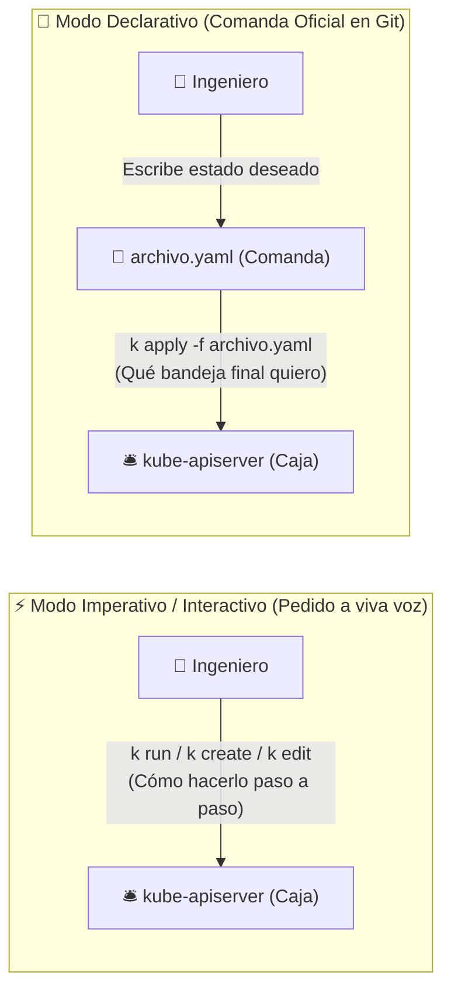
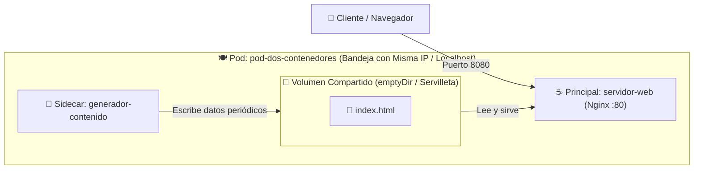
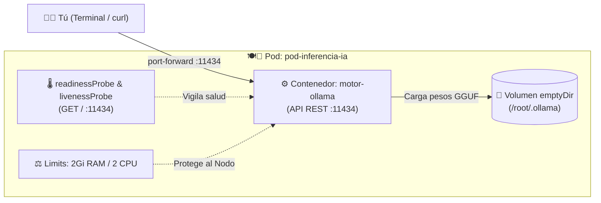
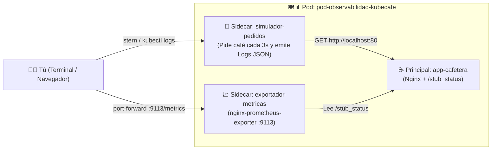

# 📂 Ejemplos Prácticos de Pods: Modo Imperativo vs. Declarativo (Semana 1)

En esta carpeta aprenderás las dos formas de trabajar con Kubernetes (**Modo Imperativo / Interactivo** y **Modo Declarativo**), los trucos de productividad en terminal (`--help`, `explain`, `--recursive`, `--dry-run`, exportación a archivos) y una colección progresiva de manifiestos YAML para dominar los **Pods**.

> [!TIP]
> En los ejemplos verás tanto `kubectl` como su alias corto **`k`** (`alias k=kubectl`). Ambos funcionan exactamente igual.

---

## 🧭 Índice Rápido

1. [⚖️ Modo Imperativo (Interactivo) vs. Modo Declarativo](#️-1-modo-imperativo-interactivo-vs-modo-declarativo)
2. [⚡ Creación Interactiva e Imperativa de Pods](#-2-creación-interactiva-e-imperativa-de-pods)
3. [🧪 Simulación con `--dry-run` y Exportación a YAML (`> file.yaml`)](#-3-simulación-con---dry-run-y-exportación-a-yaml--fileyaml)
4. [📖 Ayuda Integrada en Terminal: `--help`, `kubectl explain` y `--recursive`](#-4-ayuda-integrada-en-terminal---help-kubectl-explain-y---recursive)
5. [🔄 Ciclo de Vida con Manifiestos (`-f`): `apply`, `create`, `replace/edit` y `delete`](#-5-ciclo-de-vida-con-manifiestos--f-apply-create-replaceedit-y-delete)
6. [📑 Catálogo de Manifiestos YAML de Ejemplo (Las Bandejas de KubeCafé)](#-6-catálogo-de-manifiestos-yaml-de-ejemplo-las-bandejas-de-kubecafé)
7. [☕ Ejemplo 01: Tu Primer Pod Básico (`hola-medellin`)](#-7-detalle-y-ejecución-de-ejemplo-01-tu-primer-pod-básico-01-mi-primer-podyaml)
8. [🥛 Ejemplo 02: Multi-Contenedor y Sidecar (`pod-dos-contenedores`)](#-8-detalle-y-ejecución-de-ejemplo-02-pod-multi-contenedor--patrón-sidecar-02-pod-multi-contenedoryaml)
9. [⚖️ Ejemplo 03: Recursos y Variables con Downward API (`pod-recursos-y-variables`)](#-9-detalle-y-ejecución-de-ejemplo-03-recursos-y-variables-con-downward-api-03-pod-con-recursos-y-envyaml)
10. [🧼 Ejemplo 04: Inicialización con InitContainers (`pod-con-init-container`)](#-10-detalle-y-ejecución-de-ejemplo-04-inicialización-con-initcontainers-04-pod-con-init-containeryaml)
11. [🌡️ Ejemplo 05: Sondas de Salud y Auto-Recuperación (`pod-con-health-checks`)](#-11-detalle-y-ejecución-de-ejemplo-05-sondas-de-salud-y-auto-recuperación-05-pod-con-health-checksyaml)
12. [🤖 Ejemplo 06: Pod de Inferencia de IA Local con Ollama (`pod-inferencia-ia`)](#-12-detalle-y-ejecución-de-ejemplo-06-pod-de-inferencia-de-ia-local-en-kubernetes-ollama)
13. [📊 Ejemplo 07: Observabilidad Completa (`pod-observabilidad-kubecafe`)](#-13-detalle-y-ejecución-de-ejemplo-07-observabilidad-sencilla-métricas-logs-y-eventos)

---

## ⚖️ 1. Modo Imperativo (Interactivo) vs. Modo Declarativo

En Kubernetes existen dos filosofías para crear y administrar recursos. En [**☕ KubeCafé**](../../recursos/de-un-tinto-a-kubernetes.md), imagínalo como la diferencia entre **gritarle un pedido rápido al cajero** vs. **entregar la comanda oficial impresa y archivada en el Libro Contable (`etcd`)**:



| Característica | ⚡ Modo Imperativo / Interactivo | 📜 Modo Declarativo |
| :--- | :--- | :--- |
| **En ☕ KubeCafé** | Pides en el mostrador a viva voz: *"¡Sírvanme un expreso rápido!"*. | Entregas una comanda escrita y firmada con la receta exacta que queda archivada. |
| **¿Qué le dices a K8s?** | **Cómo** hacer algo mediante órdenes directas en la terminal. | **Qué** estado final deseas alcanzar descrito en un archivo `.yaml`. |
| **Comandos típicos** | `k run`, `k create`, `k expose`, `k scale`, `k edit`, `k delete pod X` | `k apply -f archivo.yaml`, `k diff -f archivo.yaml`, `k delete -f archivo.yaml` |
| **Trazabilidad / Auditoría** | ❌ Baja (si no guardas el comando, nadie sabe qué cambiaste). | ✅ Alta (el archivo YAML vive en Git con historial de commits y PRs). |
| **Idempotencia** | ❌ Si ejecutas `k run mi-pod` dos veces, la segunda vez falla (`AlreadyExists`). | ✅ Si ejecutas `k apply -f pod.yaml` 10 veces, K8s solo aplica cambios si los hay. |
| **¿Cuándo usarlo?** | Laboratorios rápidos, *troubleshooting* en vivo y exámenes (**CKA / CKAD**). | **Siempre en Producción**, ambientes compartidos, CI/CD y GitOps (ArgoCD/Flux). |

---

## ⚡ 2. Creación Interactiva e Imperativa de Pods

Sin escribir una sola línea de YAML, puedes pedirle a Kubernetes que cree Pods o abrir consolas interactivas dentro del clúster:

### A. Crear un Pod rápidamente desde la terminal (`k run`)
```bash
# Crear un Pod con Nginx exponiendo el puerto 80 y agregando etiquetas (labels):
k run pod-rapido --image=nginx:alpine --port=80 --labels="entorno=lab,semana=1"

# Verificar que está corriendo:
k get pods --show-labels
```

### B. Crear un Pod temporal e interactivo de diagnóstico (`--rm -it`)
¿Necesitas probar DNS, hacer un `curl` o un `ping` desde adentro de la red del clúster y que el Pod **se destruya automáticamente** apenas salgas de la terminal?
```bash
# Levanta un contenedor Busybox, abre una shell interactiva (-it) y lo borra al escribir 'exit' (--rm):
k run debug-red --rm -it --image=busybox:1.36 --restart=Never -- sh

# Dentro del Pod puedes probar:
# / # nslookup kubernetes.default
# / # wget -qO- http:// localhost (o IP de otro Pod)
# / # exit
```

### C. Ejecutar un comando único o abrir sesión interactiva en un Pod existente (`k exec`)
```bash
# 1. Ejecutar un comando puntual sin quedarte adentro (ej. ver la versión de Nginx o listar archivos):
k exec pod-rapido -- nginx -v
k exec pod-rapido -- ls -la /usr/share/nginx/html

# 2. Entrar de forma interactiva (-it) a la terminal del Pod:
k exec -it pod-rapido -- sh
```

---

## 🧪 3. Simulación con `--dry-run` y Exportación a YAML (`> file.yaml`)

> [!IMPORTANT]
> **El secreto de velocidad de los expertos:** Nunca escribas un archivo YAML desde cero en blanco. Usa el modo imperativo con `--dry-run=client -o yaml` para que `kubectl` te genere la plantilla perfecta y luego guárdala en un archivo con `>`.

### ¿Qué tipos de `--dry-run` existen?
1. **`--dry-run=client`:** Simula el comando **localmente en tu computador**. No envía nada al clúster (incluso funciona sin conexión al clúster). Ideal para generar plantillas YAML.
2. **`--dry-run=server`:** Envía la petición al **API Server** real para validar permisos RBAC, cuotas y *Admission Controllers*, pero **no guarda el objeto en `etcd`** (no crea el Pod de verdad). Ideal para validar si tu YAML será aceptado en producción.

### Ejemplos prácticos de `--dry-run` y redirección `> file.yaml`

```bash
# 1. Ver en pantalla cómo sería el YAML de un Pod sin crearlo en el clúster:
k run mi-servidor --image=nginx:alpine --port=80 --dry-run=client -o yaml

# 2. Exportar esa plantilla directamente a un archivo YAML listo para editar y versionar en Git:
k run mi-servidor --image=nginx:alpine --port=80 --dry-run=client -o yaml > mi-servidor-pod.yaml

# 3. Crear un Pod con variables de entorno y comando personalizado y guardarlo en archivo:
k run tarea-batch --image=busybox:1.36 --env="CIUDAD=Medellin" --dry-run=client -o yaml -- sh -c "echo Hola && sleep 3600" > tarea-batch.yaml

# 4. Validar contra el servidor si un archivo YAML existente tiene errores antes de aplicarlo:
k apply -f 01-mi-primer-pod.yaml --dry-run=server

# 5. Exportar el manifiesto completo de un Pod que YA está corriendo en el clúster a un archivo:
k get pod hola-medellin -o yaml > hola-medellin-backup.yaml
```

---

## 📖 4. Ayuda Integrada en Terminal: `--help`, `kubectl explain` y `--recursive`

¿Olvidaste cómo se escribe un comando o en qué nivel de indentación va `livenessProbe` o `resources` dentro de un Pod? **Kubernetes trae toda su documentación integrada dentro de `kubectl`.**

### A. `--help` (o `-h`): Ejemplos listos para copiar en cada comando
Cada subcomando de `kubectl` incluye docenas de ejemplos reales al ejecutar `--help`:
```bash
# Ver todos los ejemplos oficiales de cómo usar 'kubectl run':
k run --help

# Ver opciones y ejemplos de 'apply', 'create' o 'delete':
k apply --help
k create --help
```

### B. `kubectl explain`: El diccionario interactivo de manifiestos YAML
`kubectl explain` consulta el esquema OpenAPI de tu clúster y te explica qué hace cada campo, si es obligatorio (`required`) y qué tipo de dato recibe (`string`, `integer`, `Object`, `[]Object`):

```bash
# 1. Explicar la estructura raíz de un Pod (apiVersion, kind, metadata, spec, status):
k explain pod

# 2. Navegar hacia adentro usando puntos (.) igual que en el árbol YAML:
k explain pod.spec
k explain pod.spec.containers
k explain pod.spec.containers.ports
k explain pod.spec.containers.livenessProbe
k explain pod.spec.containers.resources
```

### C. `kubectl explain <recurso> --recursive`: Ver el árbol completo de campos
Si no recuerdas cómo se llama un campo ni dónde está ubicado, agrega **`--recursive`** para imprimir toda la jerarquía de propiedades del recurso:

```bash
# 1. Ver absolutamente todos los campos posibles que existen dentro de un Pod:
k explain pod --recursive

# 2. Ver solo el árbol de campos dentro de 'pod.spec.containers':
k explain pod.spec.containers --recursive

# 3. Truco Ninja: Combinar '--recursive' con 'grep' para buscar un campo por palabra clave:
k explain pod.spec --recursive | grep -i -C 3 "probe"
```

---

## 🔄 5. Ciclo de Vida con Manifiestos (`-f`): `apply`, `create`, `replace/edit` y `delete`

La bandera **`-f`** (`--filename`) le indica a `kubectl` que lea uno o varios archivos YAML (o incluso un directorio entero o una URL).

### Resumen de comandos sobre archivos (`-f`)

| Acción | Comando | ¿Qué hace exactamente? |
| :--- | :--- | :--- |
| **Aplicar (Crear o Actualizar)** | `k apply -f archivo.yaml` | **Estándar Declarativo.** Si el recurso no existe, lo crea; si ya existe, calcula las diferencias y aplica solo el cambio. |
| **Crear (Estricto)** | `k create -f archivo.yaml` | **Imperativo con archivo.** Crea el recurso desde el YAML, pero **da error** si el objeto ya existe en el clúster. |
| **Comparar antes de actualizar** | `k diff -f archivo.yaml` | Muestra en pantalla qué líneas cambiarían en el clúster si ejecutaras `k apply -f`. |
| **Actualizar / Reemplazar** | `k replace -f archivo.yaml` | Sustituye el objeto vivo por la definición completa del archivo (requiere que el objeto ya exista). |
| **Recrear forzosamente** | `k replace --force -f archivo.yaml` | Borra el Pod y lo vuelve a crear de inmediato (muy útil porque muchos campos de un Pod son inmutables tras crearse). |
| **Actualizar en caliente** | `k edit pod <nombre>` o `k set image...` | Abre el YAML vivo en tu editor (`vim`/`nano`) o actualiza un campo puntual sin tocar tu archivo local. |
| **Eliminar** | `k delete -f archivo.yaml` | Borra del clúster únicamente los recursos que están definidos dentro de ese archivo `.yaml`. |

### 💻 Laboratorio Paso a Paso: Crear, Actualizar y Eliminar con `-f`

Ejecuta estos comandos desde la carpeta `semana-01-arquitectura/1.ejemplos/`:

```bash
# 1. CREAR / APLICAR en modo declarativo:
k apply -f 01-mi-primer-pod.yaml

# (Si intentas usar 'k create -f 01-mi-primer-pod.yaml' ahora, verás el error AlreadyExists,
# mientras que 'k apply -f 01-mi-primer-pod.yaml' te dirá 'unchanged' sin fallar).

# 2. ACTUALIZAR (Update) el Pod:
# Opción A (Declarativa - Recomendada): Agregar una etiqueta o cambiar la imagen y volver a aplicar:
k label -f 01-mi-primer-pod.yaml ambiente=desarrollo --overwrite
k apply -f 01-mi-primer-pod.yaml

# Opción B (Actualizar la imagen de un contenedor en vivo de forma imperativa):
k set image pod/hola-medellin servidor-web=nginx:1.27-alpine

# Opción C (Editar el YAML en vivo desde la terminal):
k edit pod hola-medellin

# Opción D (Si cambiaste un campo inmutable en tu archivo YAML local, recréalo con replace --force):
k replace --force -f 01-mi-primer-pod.yaml

# 3. ELIMINAR el recurso usando el mismo manifiesto:
k delete -f 01-mi-primer-pod.yaml

# (O aplicar / eliminar TODOS los manifiestos de una carpeta de un solo golpe):
k apply -f .
k delete -f .
```

---

## 📑 6. Catálogo de Manifiestos YAML de Ejemplo (Las Bandejas de KubeCafé)

> ⚠️ **¡Atención a los nombres!**  
> El **nombre del archivo `.yaml`** es lo que pasas con la bandera `-f` (ej: `k apply -f 01-mi-primer-pod.yaml`).  
> El **nombre del Pod en el clúster (`metadata.name`)** es lo que le pides a Kubernetes en comandos de inspección (ej: `k get pod hola-medellin`, `k logs`, `k port-forward`). No son necesariamente iguales.

| # | Archivo YAML | Nombre del Pod (`metadata.name`) | Tipo de Pod | En ☕ KubeCafé | Concepto Técnico Clave |
| :-: | :--- | :--- | :--- | :--- | :--- |
| **01** | [`01-mi-primer-pod.yaml`](./01-mi-primer-pod.yaml) | `hola-medellin` | Pod Básico (1 Contenedor) | 🍽️ Bandeja con 1 ☕ taza de café | Estructura básica mínima de un Pod en Kubernetes. |
| **02** | [`02-pod-multi-contenedor.yaml`](./02-pod-multi-contenedor.yaml) | `pod-dos-contenedores` | **Multi-Contenedor (2 Contenedores)** | 🍽️ Bandeja con ☕ taza principal + 🥛 vaso de agua | Patrón *Sidecar* con volumen temporal compartido (`emptyDir`). |
| **03** | [`03-pod-con-recursos-y-env.yaml`](./03-pod-con-recursos-y-env.yaml) | `pod-recursos-y-variables` | Pod con Variables y Recursos | ⚖️ Medidor de agua/cafetera y 🧂 azúcar del día | `requests`, `limits` de CPU/RAM y Downward API (`fieldRef`). |
| **04** | [`04-pod-con-init-container.yaml`](./04-pod-con-init-container.yaml) | `pod-con-init-container` | Pod con `initContainers` | 🧼 Calentar y limpiar la máquina antes de servir | Tareas previas bloqueantes antes de iniciar la app principal. |
| **05** | [`05-pod-con-health-checks.yaml`](./05-pod-con-health-checks.yaml) | `pod-con-health-checks` | Pod con Sondas de Salud | 🌡️ Termómetro para saber si el café sigue caliente | `readinessProbe` y `livenessProbe` para auto-recuperación. |
| **06** | [`06-pod-inferencia-ia-ollama.yaml`](./06-pod-inferencia-ia-ollama.yaml) | `pod-inferencia-ia` | **🤖 Pod de Inferencia de IA (LLM)** | 🤖 Barista Sommelier con IA Local en la bandeja | Inferencia LLM en CPU con **Ollama**, volumen `emptyDir`, `resources` y `Probes`. |
| **07** | [`07-pod-observabilidad-metricas-logs.yaml`](./07-pod-observabilidad-metricas-logs.yaml) | `pod-observabilidad-kubecafe` | **📊 Pod con Observabilidad (3 Contenedores)** | 📈 Manómetro de máquina + Bitácora JSON en vivo | Exportador de métricas **Prometheus (`:9113/metrics`)** + simulador de logs JSON. |

---

## ☕ 7. Detalle y Ejecución de Ejemplo 01: Tu Primer Pod Básico (`01-mi-primer-pod.yaml`)

* **Archivo YAML:** [`01-mi-primer-pod.yaml`](./01-mi-primer-pod.yaml)
* **Nombre del Pod en el clúster:** **`hola-medellin`**
* **Contenedor:** `servidor-web` (`nginx:alpine` escuchando en puerto `80`)
* **En ☕ KubeCafé:** Es la comanda más sencilla: una bandeja (`Pod`) con una sola taza de café (`servidor-web`).

### 🚀 Paso a Paso de Ejecución:

#### 1. Aplicar el manifiesto
```bash
k apply -f 01-mi-primer-pod.yaml
```

#### 2. Verificar que esté corriendo y revisar sus etiquetas (Labels)
```bash
# Ver el Pod con su IP interna y el Nodo donde fue asignado:
k get pod hola-medellin -o wide

# Ver las etiquetas configuradas (comunidad=cloud-native-medellin, semana=1):
k get pod hola-medellin --show-labels
```

#### 3. Probar el servidor web desde tu navegador con `port-forward`
Abre un túnel temporal hacia el puerto `80` del contenedor:
```bash
k port-forward pod/hola-medellin 8080:80
```
👉 Abre en tu navegador **[http://localhost:8080](http://localhost:8080)** (o ejecuta en otra terminal `curl http://localhost:8080`) y verás la pantalla de bienvenida de Nginx. Presiona `Ctrl + C` para cerrar el túnel.

#### 4. Inspeccionar los metadatos y eventos del Pod
```bash
k describe pod hola-medellin
```

#### 5. Limpiar el recurso cuando termines
```bash
k delete -f 01-mi-primer-pod.yaml
```

---

## 🥛 8. Detalle y Ejecución de Ejemplo 02: Pod Multi-Contenedor / Patrón Sidecar (`02-pod-multi-contenedor.yaml`)

* **Archivo YAML:** [`02-pod-multi-contenedor.yaml`](./02-pod-multi-contenedor.yaml)
* **Nombre del Pod en el clúster:** **`pod-dos-contenedores`**
* **Contenedores:**
  1. `servidor-web` (Nginx en puerto 80 — ☕ Taza Principal)
  2. `generador-contenido` (Busybox actualizando `index.html` cada 5s — 🥛 Sidecar / Vaso de Agua)
* **Volumen compartido:** `contenido-compartido` (`emptyDir`)



### ¿Qué comparten dos contenedores en el mismo Pod?
* **Red:** Comparten la misma dirección IP y el espacio de red. Pueden comunicarse entre sí usando `localhost:<puerto>`. (⚠️ **Ojo:** No pueden escuchar en el mismo puerto).
* **Almacenamiento:** Mediante volúmenes de tipo `emptyDir`, pueden leer y escribir en el mismo directorio del sistema de archivos.
* **Ciclo de vida:** Son programados juntos en el mismo Worker Node y mueren juntos.

### 🚀 Paso a Paso de Ejecución:

#### 1. Aplicar el manifiesto
```bash
k apply -f 02-pod-multi-contenedor.yaml
```

#### 2. Ver el estado de los contenedores (`READY 2/2`)
Observa la columna `READY` (marcará `2/2` cuando ambos contenedores estén listos):
```bash
k get pod pod-dos-contenedores
```

#### 3. Ver logs de un contenedor específico con `-c`
Cuando un Pod tiene más de un contenedor, debes especificar a cuál le pides logs usando `-c`:
```bash
# Logs del servidor web principal:
k logs pod-dos-contenedores -c servidor-web

# Logs o salida del contenedor generador sidecar:
k logs pod-dos-contenedores -c generador-contenido
```

#### 4. Entrar a la terminal de un contenedor específico
```bash
k exec -it pod-dos-contenedores -c servidor-web -- sh
# Dentro puedes ver el archivo compartido:
# cat /usr/share/nginx/html/index.html
# exit
```

#### 5. Probar el resultado en vivo en tu navegador
```bash
k port-forward pod/pod-dos-contenedores 8080:80
```
Abre en tu navegador **[http://localhost:8080](http://localhost:8080)** y refresca cada pocos segundos para ver la fecha y hora actualizarse dinámicamente gracias al trabajo en equipo de ambos contenedores.

#### 6. Limpiar el recurso
```bash
k delete -f 02-pod-multi-contenedor.yaml
```

---

## ⚖️ 9. Detalle y Ejecución de Ejemplo 03: Recursos y Variables con Downward API (`03-pod-con-recursos-y-env.yaml`)

* **Archivo YAML:** [`03-pod-con-recursos-y-env.yaml`](./03-pod-con-recursos-y-env.yaml)
* **Nombre del Pod en el clúster:** **`pod-recursos-y-variables`**
* **Contenedor:** `app-demo` (`busybox:1.36`)
* **En ☕ KubeCafé:** Es como calibrar la cafetera con la cantidad exacta de agua y café (**Requests y Limits**) para no desbordar la mesa, y pasarle notas adhesivas con el menú del día (**Variables de Entorno**).

### Conceptos Clave:
1. **Variables Estáticas:** Valores fijos (`ENTORNO_APP="laboratorio-medellin"`, `MENSAJE_BIENVENIDA`).
2. **Downward API (`valueFrom.fieldRef`):** Permite que el contenedor conozca información sobre sí mismo generada por Kubernetes en tiempo de ejecución (su propio nombre `metadata.name` y su IP asignada `status.podIP`).
3. **`requests` (Garantía mínima):** Lo que el Scheduler busca que tenga libre el nodo para poder colocar el Pod (`50m` de CPU = 0.05 núcleos, `64Mi` de RAM).
4. **`limits` (Techo máximo):** Si el contenedor intenta usar más de `200m` de CPU será limitado (*throttling*); si supera `128Mi` de RAM será terminado por el sistema (*OOMKilled*).

### 🚀 Paso a Paso de Ejecución:

#### 1. Aplicar el manifiesto
```bash
k apply -f 03-pod-con-recursos-y-env.yaml
```

#### 2. Verificar que esté en ejecución
```bash
k get pod pod-recursos-y-variables
```

#### 3. Ver en los logs las variables inyectadas y la IP del Pod
El contenedor ejecuta un script que imprime sus variables de entorno cada 15 segundos:
```bash
k logs pod-recursos-y-variables -f
```
Verás una salida similar a:
```text
=== Contenedor con variables y límites configurados ===
Entorno: laboratorio-medellin
Mensaje: Bienvenidos a Fundamentos de Kubernetes
Nombre del Pod (Downward API): pod-recursos-y-variables
IP del Pod: 10.244.0.7
[Wed Nov 11 21:00:00 UTC 2026] Pod 'pod-recursos-y-variables' operando normalmente con memoria y CPU limitadas...
```
*(Presiona `Ctrl + C` para salir del seguimiento de logs).*

#### 4. Validar las variables directamente dentro del contenedor (`k exec`)
```bash
k exec pod-recursos-y-variables -- env | grep -E "ENTORNO|MENSAJE|MI_POD"
```

#### 5. Comprobar los límites y peticiones de recursos
```bash
k describe pod pod-recursos-y-variables | grep -A 8 "Limits:"
```

#### 6. Limpiar el recurso
```bash
k delete -f 03-pod-con-recursos-y-env.yaml
```

---

## 🧼 10. Detalle y Ejecución de Ejemplo 04: Inicialización con InitContainers (`04-pod-con-init-container.yaml`)

* **Archivo YAML:** [`04-pod-con-init-container.yaml`](./04-pod-con-init-container.yaml)
* **Nombre del Pod en el clúster:** **`pod-con-init-container`**
* **InitContainer:** `inicializador` (`busybox:1.36` preparando `/trabajo/index.html`)
* **Contenedor Principal:** `servidor-web` (`nginx:alpine` montando `/usr/share/nginx/html`)
* **Volumen compartido:** `datos-inicio` (`emptyDir`)
* **En ☕ KubeCafé:** Antes de que el barista principal abra la estación al público, un asistente de limpieza enjuaga la máquina, calienta el agua y coloca los vasos limpios (**`initContainers`**). Solo cuando termina con éxito, entra a operar el barista principal.

### Reglas de los `initContainers`:
* Siempre se ejecutan **antes** de los contenedores de la sección `containers`.
* Si hay varios `initContainers`, se ejecutan **en orden secuencial estricto**, uno tras otro.
* **Deben finalizar con código de salida 0**. Si fallan, Kubernetes reinicia el Pod hasta que tengan éxito.

### 🚀 Paso a Paso de Ejecución:

#### 1. Aplicar el manifiesto y vigilar la transición de estados en vivo
Ejecuta el `apply` y de inmediato quédate observando el estado con `-w` (*watch*):
```bash
k apply -f 04-pod-con-init-container.yaml && k get pod pod-con-init-container -w
```
Observarás la secuencia exacta de vida:
```text
NAME                     READY   STATUS     RESTARTS   AGE
pod-con-init-container   0/1     Init:0/1   0          1s   <-- El initContainer está trabajando (duerme 4s)
pod-con-init-container   0/1     PodInitializing 0     5s   <-- El initContainer terminó con código 0
pod-con-init-container   1/1     Running    0          6s   <-- Arrancó el servidor web principal
```
*(Presiona `Ctrl + C` para detener el modo watch).*

#### 2. Inspeccionar los logs del InitContainer que ya finalizó
Para pedirle logs a un initContainer, usa `-c <nombre-del-init-container>`:
```bash
k logs pod-con-init-container -c inicializador
```
Salida esperada:
```text
[InitContainer] Preparando archivos y verificando dependencias...
[InitContainer] Finalizado con éxito.
```

#### 3. Comprobar que Nginx está sirviendo el archivo generado por el InitContainer
Abre un túnel y pruébalo:
```bash
k port-forward pod/pod-con-init-container 8080:80
```
Abre en tu navegador **[http://localhost:8080](http://localhost:8080)** o ejecuta:
```bash
curl http://localhost:8080
```
Verás la página que dice: `✅ Inicialización Exitosa - Este archivo fue generado por el initContainer antes de que Nginx iniciara.`

#### 4. Limpiar el recurso
```bash
k delete -f 04-pod-con-init-container.yaml
```

---

## 🌡️ 11. Detalle y Ejecución de Ejemplo 05: Sondas de Salud y Auto-Recuperación (`05-pod-con-health-checks.yaml`)

* **Archivo YAML:** [`05-pod-con-health-checks.yaml`](./05-pod-con-health-checks.yaml)
* **Nombre del Pod en el clúster:** **`pod-con-health-checks`**
* **Contenedor:** `servidor-saludable` (`nginx:alpine` escuchando en puerto `80`)
* **En ☕ KubeCafé:** Son los controles de calidad del barista:
  * **`readinessProbe` (¿Listo para servir?):** Termómetro que revisa si el agua está a 90°C antes de dejar pasar a los clientes a la mesa. Si el agua está fría, el mesero no lleva clientes a esa mesa (el Pod no recibe tráfico de Services).
  * **`livenessProbe` (¿Sigue viva la máquina?):** Si la máquina cafetera se traba o saca humo, el supervisor la reinicia de fábrica inmediatamente (**Self-Healing / Auto-recuperación**).

### Diferencia Vital entre Sondas:
| Sonda | Pregunta que hace K8s | ¿Qué pasa si falla? |
| :--- | :--- | :--- |
| **`readinessProbe`** | ¿Está la aplicación lista para atender peticiones? | El Pod pasa a `0/1 NotReady` y Kubernetes **deja de enviarle tráfico**, pero **NO lo reinicia**. |
| **`livenessProbe`** | ¿Está la aplicación viva o se quedó congelada/bloqueada? | Kubernetes **mata el contenedor y lo reinicia automáticamente** para restaurar el servicio. |

### 🚀 Paso a Paso de Ejecución:

#### 1. Aplicar el manifiesto y observar el retardo inicial
```bash
k apply -f 05-pod-con-health-checks.yaml && k get pod pod-con-health-checks -w
```
Nota que durante los primeros 3 segundos (`initialDelaySeconds: 3`) el Pod figura como `0/1 Running` (no listo aún). Tan pronto la `readinessProbe` recibe el primer `HTTP 200 OK`, cambia a **`1/1 Running`**.

#### 2. Inspeccionar la configuración de las sondas
```bash
k describe pod pod-con-health-checks | grep -E "Liveness|Readiness" -A 3
```

#### 3. 🧪 Experimento en Vivo: Simular una falla y ver la Auto-Recuperación (Self-Healing)
Vamos a entrar al contenedor y "romper" intencionalmente el archivo que vigilan las sondas para ver cómo reacciona Kubernetes:

```bash
# 1. En una terminal, deja corriendo la vigilancia del Pod:
k get pod pod-con-health-checks -w

# 2. En otra terminal, renombra el archivo index.html para que devuelva error 404:
k exec pod-con-health-checks -- mv /usr/share/nginx/html/index.html /usr/share/nginx/html/index.bak
```

**¿Qué verás suceder en pocos segundos?**
1. A los 5 segundos (`periodSeconds: 5`), la **`readinessProbe`** falla con código 404. El Pod pasa de `1/1` a **`0/1 NotReady`**.
2. A los 10-15 segundos, la **`livenessProbe`** también falla consecutivamente. Kubernetes detecta que la aplicación está rota, **mata el contenedor y lo vuelve a crear desde cero**.
3. Verás en la terminal que la columna **`RESTARTS` pasa a `1`** y el Pod vuelve a estar `1/1 Running` con su archivo original restaurado. ¡Magia de alta disponibilidad!

#### 4. Limpiar el recurso
```bash
k delete -f 05-pod-con-health-checks.yaml
```

---

## 🤖 12. Detalle y Ejecución de Ejemplo 06: Pod de Inferencia de IA Local en Kubernetes (Ollama)

* **Archivo YAML:** [`06-pod-inferencia-ia-ollama.yaml`](./06-pod-inferencia-ia-ollama.yaml)
* **Nombre del Pod en el clúster:** **`pod-inferencia-ia`**
* **Contenedor:** `motor-ollama` (`ollama/ollama:latest` en puerto `11434`)
* **En ☕ KubeCafé:** Es nuestro **Barista Sommelier con Inteligencia Artificial** dentro de la cafetería, capaz de responder preguntas técnicas sobre recetas y Kubernetes en tiempo real, **100% gratis**, **privado** y corriendo en **CPU**.



### 🚀 Paso a Paso de Ejecución:

#### 1. Desplegar el Pod de Inferencia
```bash
k apply -f 06-pod-inferencia-ia-ollama.yaml

# Verificar que pase a Running y 1/1 Ready:
k get pod pod-inferencia-ia -w
```

#### 2. Descargar un micro-modelo ultra ligero (~90 MB, ideal para CPU)
Usaremos **`smollm2:135m`** (solo ~90 MB) o **`qwen2.5:0.5b`** (~390 MB) para que descargue en pocos segundos y corra fluido en cualquier computador:
```bash
k exec -it pod-inferencia-ia -- ollama pull smollm2:135m
```

#### 3. Opción A — Chatear de forma interactiva desde la terminal (`k exec -it`)
```bash
k exec -it pod-inferencia-ia -- ollama run smollm2:135m "Explain what a Kubernetes Pod is in two short sentences"
```

#### 4. Opción B — Consumir el Pod como una API REST de Inferencia (`port-forward` + `curl`)
Abre un túnel hacia el puerto `11434` del Pod:
```bash
k port-forward pod/pod-inferencia-ia 11434:11434
```
Y en otra pestaña de tu terminal, envíale una petición HTTP JSON:
```bash
curl http://localhost:11434/api/generate -d '{
  "model": "smollm2:135m",
  "prompt": "Why do we use containers and Kubernetes?",
  "stream": false
}'
```

#### 5. Limpiar el recurso cuando termines
```bash
k delete -f 06-pod-inferencia-ia-ollama.yaml
```

---

## 📊 13. Detalle y Ejecución de Ejemplo 07: Observabilidad Sencilla (Métricas, Logs y Eventos)

* **Archivo YAML:** [`07-pod-observabilidad-metricas-logs.yaml`](./07-pod-observabilidad-metricas-logs.yaml)
* **Nombre del Pod en el clúster:** **`pod-observabilidad-kubecafe`**
* **Contenedores:**
  1. `configurar-medidor-nginx` (*initContainer* que configura `/stub_status` en Nginx)
  2. `app-cafetera` (Nginx en puerto 80 — Servidor principal)
  3. `exportador-metricas` (*Sidecar* Prometheus exporter en puerto 9113)
  4. `simulador-pedidos` (*Sidecar* Busybox generando pedidos cada 3s y logs JSON)



### 🚀 Paso a Paso de Ejecución:

#### Paso 1: Activar `Metrics Server` en Kind (Para habilitar `kubectl top`, `k9s` y `Headlamp`)
Si aún no tienes `metrics-server` en tu clúster Kind, actívalo en **10 segundos**:
```bash
# 1. Instalar el Metrics Server oficial de Kubernetes:
k apply -f https://github.com/kubernetes-sigs/metrics-server/releases/latest/download/components.yaml

# 2. Habilitar certificados locales de Kind (--kubelet-insecure-tls):
k patch deployment metrics-server -n kube-system --type='json' \
  -p='[{"op": "add", "path": "/spec/template/spec/containers/0/args/-", "value": "--kubelet-insecure-tls"}]'
```

Verifica el consumo de tus nodos y pods:
```bash
k top nodes
k top pods --containers
```

#### Paso 2: Desplegar el Pod de Observabilidad
```bash
k apply -f 07-pod-observabilidad-metricas-logs.yaml

# Observa que alcance READY 3/3:
k get pod pod-observabilidad-kubecafe
```

#### Paso 3: Observar Logs Estructurados (JSON) en Tiempo Real
```bash
# Opción 1: Con kubectl nativo viendo el contenedor simulador:
k logs -f pod-observabilidad-kubecafe -c simulador-pedidos

# Opción 2: Con 'stern' viendo los contenedores simultáneamente a color:
stern pod-observabilidad-kubecafe
```
Verás fluir líneas JSON estructuradas:
```json
{"timestamp":"2026-11-11T21:00:03Z","nivel":"INFO","servicio":"kubecafe","pedido_id":14,"bebida":"expreso","estado":"servido_200_ok"}
```

#### Paso 4: Inspeccionar Métricas en Formato Prometheus (`:9113/metrics`)
Abre un túnel hacia el contenedor `exportador-metricas`:
```bash
k port-forward pod/pod-observabilidad-kubecafe 9113:9113
```
En otra terminal (o en tu navegador en **[http://localhost:9113/metrics](http://localhost:9113/metrics)**):
```bash
curl -s http://localhost:9113/metrics | grep ^nginx_
```
Verás cómo el contador de peticiones `nginx_http_requests_total` aumenta dinámicamente con cada pedido servido.

#### Paso 5: Radar de Eventos del Clúster en Vivo
```bash
k get events --sort-by='.lastTimestamp' -w
```

#### Paso 6: Limpiar el recurso
```bash
k delete -f 07-pod-observabilidad-metricas-logs.yaml
```
