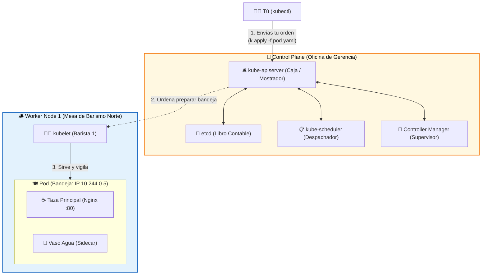

# 🌱 Semana 1: El motor por dentro y tu primer Pod

¡Bienvenido a la primera semana! Hoy pasaremos de entender qué hace Kubernetes en teoría a levantar nuestro propio clúster local y desplegar nuestra primera aplicación.

> 📊 **Presentación de la Semana 01 (PDF):** [**Descargar `1.KubeCafe-De-Docker-a-Kubernetes.pdf`**](../recursos/diapositivas/1.KubeCafe-De-Docker-a-Kubernetes.pdf)  
> 🎮 **Simulador Visual Interactivo (Paso a Paso):** [**Abrir Simulador de Arquitectura K8s en el Navegador**](https://edwinbermudez91.github.io/Fundamentos-Kubernetes/recursos/simulador-interactivo-kubernetes.html) *(o abre localmente [`../recursos/simulador-interactivo-kubernetes.html`](../recursos/simulador-interactivo-kubernetes.html))*  
> 🇨🇴 **Comunidad Oficial CNCF:** [**Únete a Cloud Native Medellín en CNCF Community Groups**](https://ocgroups.dev/cncf/group/2majk4r)  
> 📚 **Documentación Oficial de Kubernetes:** [**Documentación Principal (Español)**](https://kubernetes.io/es/docs/home/) • [**Cheat Sheet Oficial de kubectl**](https://kubernetes.io/es/docs/reference/kubectl/cheatsheet/) • [**Componentes de la Arquitectura K8s**](https://kubernetes.io/es/docs/concepts/overview/components/) • [**Guía Oficial de Pods**](https://kubernetes.io/es/docs/concepts/workloads/pods/) • [**InitContainers**](https://kubernetes.io/es/docs/concepts/workloads/pods/init-containers/) • [**Documentación Oficial de Kind**](https://kind.sigs.k8s.io/)

---

## 🧠 Resumen en 2 minutos: Bienvenido a ☕ KubeCafé

En la **Semana 00** aprendimos a tostar el **🌱 Grano verde** (`Código`), seguir la **📜 Receta** (`Dockerfile`), empacar la **📦 Bolsa sellada** (`Imagen Docker`) y servir una **☕ Taza de café** (`Contenedor`).

Ahora en la **Semana 01** abrimos nuestra cafetería de especialidad (**KubeCafé**), donde todo está organizado entre la **🏢 Oficina de Gerencia (`Control Plane`)** y las **🪵 Mesas de Barismo (`Worker Nodes`)**:

> 💡 **Palabras clave de la cafetería en lenguaje cotidiano:**
> * **👨‍🍳 Barista:** Es la persona experta que prepara las bebidas de café detrás de la barra y maneja la máquina cafetera (en Kubernetes es el **`kubelet`**).
> * **🪵 Barismo / Mesa de barismo:** El *barismo* es el oficio de preparar buen café. Una *mesa de barismo* es el mesón o estación de trabajo donde están conectadas las **cafeteras / máquinas de café** (**CPU**) y el agua (**RAM**) para preparar las tazas (representa un **`Worker Node`** o servidor).
> * **🧾 Pedido / Orden:** La solicitud escrita donde se detalla exactamente qué recursos o características necesita la aplicación (representa tu archivo manifiesto **`.yaml`**).
> * **🥛 Sidecar (Acompañante):** Como el vasito de agua que te sirven en la misma bandeja junto al café; es un contenedor auxiliar que acompaña al contenedor principal dentro del mismo **`Pod`**.

| Componente Técnico | En ☕ KubeCafé | ¿Cuál es su función en la cafetería y en el clúster? |
| :--- | :--- | :--- |
| **Contenedor** | ☕ **Taza de café servida** | La bebida lista y ejecutándose en memoria/CPU. |
| **Pod** | 🍽️ **Bandeja de servicio** | Unidad mínima de K8s: lleva la **☕ taza de café principal** + el **🥛 vaso de agua** (*Sidecar*). Nunca se sirven tazas sueltas sin bandeja. |
| **Worker Node** | 🪵 **Mesa de barismo** | Estación de trabajo física o virtual con agua (**RAM**) y cafeteras (**CPU**). |
| **Kubelet** | 👨‍🍳 **Barista de la mesa** | Agente en cada nodo: recibe órdenes de gerencia y vigila que las tazas no se enfríen. |
| **Control Plane** | 🏢 **Oficina de Gerencia** | Coordina toda la cafetería sin preparar café directamente. |
| **kube-apiserver** | 🛎️ **Caja / Mostrador** | Ventanilla única: todos tus comandos (`kubectl`) y reportes entran por aquí. |
| **etcd** | 📖 **Libro contable** | Base de datos llave-valor inmutable donde se registran todas las órdenes activas y el estado de las mesas. |
| **kube-scheduler** | 📋 **Despachador de mesas** | Mira qué mesa de barismo tiene cafetera y agua libre para asignar la bandeja (`Pod`). |
| **Controller Manager** | 🧐 **Supervisor de salón** | Si una taza se derrama, detecta la falta y ordena preparar otra inmediatamente. |

👉 *¿Quieres ver cómo se conecta KubeCafé hasta la Semana 06 (Services, Ingress, ConfigMaps, Secrets, PV y Helm)? Lee: [**☕ Kubernetes explicado con la Analogía del Café (KubeCafé)**](../recursos/de-un-tinto-a-kubernetes.md).*



---

## 🧪 Laboratorio en Vivo (Hands-on)

> [!TIP]
> **¿Prefieres practicar en el navegador sin levantar un clúster local?**  
> Puedes realizar ejercicios interactivos guiados con terminal en la nube en [**KodeKloud Studio — Kubernetes Labs**](https://kodekloud.com/studio/labs/kubernetes).

### Paso 1: Crea tu clúster local
Si usas **Kind**, abre tu terminal y ejecuta:
```bash
kind create cluster --name cnm-lab
```
Verifica que tu clúster esté vivo:
```bash
kubectl cluster-info
kubectl get nodes
```

### Paso 2: Despliega tu primer Pod (y explora los 7 ejemplos prácticos)
Explora la carpeta [`1.ejemplos`](./1.ejemplos) y aplica el primer Pod básico en tu clúster:
```bash
kubectl apply -f semana-01-arquitectura/1.ejemplos/01-mi-primer-pod.yaml
```
> 💡 **Nota sobre los nombres:** El archivo es `01-mi-primer-pod.yaml`, pero el Pod creado en el clúster se llama **`hola-medellin`** (`metadata.name`).

Revisa que esté corriendo (`Running`):
```bash
kubectl get pods
```

*(Tienes **7 ejemplos progresivos** en [`1.ejemplos/`](./1.ejemplos): Pod básico `hola-medellin`, multi-contenedor/sidecar `pod-dos-contenedores`, recursos/variables `pod-recursos-y-variables`, initContainers `pod-con-init-container`, sondas de salud `pod-con-health-checks`, inferencia de IA local `pod-inferencia-ia` y observabilidad `pod-observabilidad-kubecafe` — [ver catálogo y comandos paso a paso](./1.ejemplos/README.md)).*

### Paso 3: Conéctate a tu Pod desde tu navegador
Usa `port-forward` para abrir un túnel desde tu computador hasta el Pod:
```bash
kubectl port-forward pod/hola-medellin 8080:80
```
👉 Abre en tu navegador **[http://localhost:8080](http://localhost:8080)** y verás tu servidor respondiendo.

### Paso 4: Visualiza tu clúster con la consola Open Source (Headlamp)
Para gestionar y entender mucho más rápido todo lo que pasa en tu clúster (nodos, pods, namespaces y eventos en tiempo real) sin depender exclusivamente de comandos en la terminal, te recomendamos usar **[Headlamp](https://headlamp.dev/)**, una consola visual open source moderna respaldada por Kubernetes SIGs.

Puedes utilizarla de tres formas según lo que prefieras:
1. **Como aplicación nativa de escritorio** (Windows, macOS o Linux, conectada a tu `~/.kube/config`).
2. **Dentro del clúster con Helm** (expuesta vía `NodePort` en `kube-system`).
3. **Como contenedor de Docker local**.

👉 **Sigue el tutorial paso a paso para instalarla en cualquiera de sus modalidades en:**  
🔗 [**Guía de Instalación y Uso de Headlamp (`headlamp.md`)**](./headlamp.md)

---

## 💥 Los Retos Rotos de la Semana 1 (`2.reto-roto/`)

En la carpeta [`2.reto-roto/`](./2.reto-roto) encontrarás **4 incidentes reales en KubeCafé** (+10 XP por cada reto solucionado):

| # | Archivo del Reto | ¿Qué pasó en ☕ KubeCafé? | Estado / Síntoma |
| :-: | :--- | :--- | :--- |
| **01** | [`01-pod-con-errores.yaml`](./2.reto-roto/01-pod-con-errores.yaml) | El barista buscó una 📦 **bolsa de café** con etiqueta mal escrita y puerto inválido. | `ImagePullBackOff` / Error de puerto |
| **02** | [`02-pod-crashloop.yaml`](./2.reto-roto/02-pod-crashloop.yaml) | La ☕ **taza se sirve pero se derrama** al instante porque el comando falla. | `CrashLoopBackOff` |
| **03** | [`03-pod-pendiente-infinito.yaml`](./2.reto-roto/03-pod-pendiente-infinito.yaml) | La orden del pedido pide **64 cafeteras (CPU)** y ninguna 🪵 mesa tiene capacidad. | `Pending` (`Insufficient cpu`) |
| **04** | [`04-pod-yaml-molesto.yaml`](./2.reto-roto/04-pod-yaml-molesto.yaml) | El archivo de pedido entregado en 🛎️ **Caja (`apiserver`)** tiene errores de escritura y formato YAML. | Error de validación al hacer `apply` |

### ¿Cómo superarlos y ganar hasta +40 XP?
1. Intenta aplicar cada archivo en tu clúster:
   ```bash
   kubectl apply -f semana-01-arquitectura/2.reto-roto/01-pod-con-errores.yaml
   ```
2. Investiga qué le duele usando `kubectl get pods`, `kubectl describe pod <nombre>` y `kubectl logs <nombre>`.
3. Copia los 4 archivos a `aportes-comunidad/soluciones-retos/<tu-usuario>/semana-01/`, corrígelos conservando sus nombres (`01-pod-con-errores.yaml`, `02-pod-crashloop.yaml`, `03-pod-pendiente-infinito.yaml`, `04-pod-yaml-molesto.yaml`) y envía tu **Pull Request**.

---

## 🕵️‍♂️ Diccionario Rápido: ¿Qué le duele a mi Bandeja (`Pod`) en KubeCafé?

Cuando ejecutes `kubectl get pods`, el estado (`STATUS`) te dará la primera pista de dónde buscar:

| Estado del Pod | En ☕ KubeCafé | ¿Qué significa técnicamente? | Comando para descubrir el culpable |
| :--- | :--- | :--- | :--- |
| **`Pending`** | 📋 El **Despachador (`scheduler`)** dejó el pedido en sala de espera porque ninguna mesa tiene tanta agua o cafeteras libres. | Ningún Worker Node tiene suficiente RAM/CPU libre o hay una restricción (`taint`/`nodeSelector`). | `kubectl describe pod <nombre>` *(Mira la tabla de `Events` al final)*. |
| **`ImagePullBackOff`** / **`ErrImagePull`** | 👨‍🍳 El **Barista (`kubelet`)** fue a la bodega pero esa 📦 **bolsa de café** no existe o está bajo llave. | La imagen de Docker está mal escrita, el tag no existe o el repositorio es privado. | `kubectl describe pod <nombre>` *(Revisa qué imagen intentó descargar)*. |
| **`CrashLoopBackOff`** | ☕ La **taza se sirve pero se cae al piso** una y otra vez apenas el barista la suelta. | El contenedor arrancó, pero el proceso principal adentro terminó con error o se apagó. | `kubectl logs <nombre>` *(Lee el error que arrojó la aplicación)*. |
| **`Error de validación al hacer apply`** | 🛎️ La **Caja Registradora (`apiserver`)** rechazó la orden porque el formulario YAML está mal escrito o mal indentado. | El archivo YAML tiene un error de sintaxis, indentación o un campo mal escrito. | Usa `kubectl explain pod --recursive` o revisa la línea del error en terminal. |